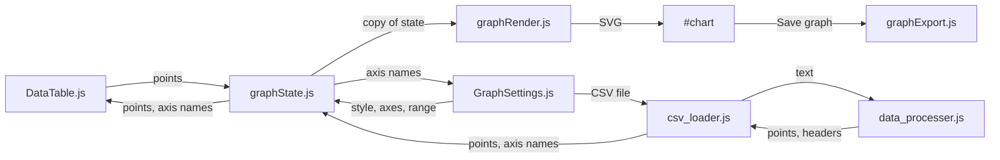

# Simpligraph

A small browser app for CSE 210 that turns X/Y data into a line or scatter graph. Type points into the table or load a CSV, style the graph, and save it as JPEG, PNG, or SVG. It is plain HTML, CSS, and JavaScript with no build step.

## Features

- Enter points in the data table, or load a CSV with `x,y` columns or `series,x,y` columns. Each series gets its own color and a legend. Example files are in `samples/`.
- Line or scatter graph, with a title, axis names, custom axis ranges, colors, point styles, an optional grid, and a transparent background.
- Axes cross at the origin when the data includes negative values.
- Clicking a point jumps to its row in the data table.
- Save the graph as JPEG, PNG, or SVG.

## Run locally

1. Install [Node.js](https://nodejs.org/) 22.5 or newer.
2. From this project folder, run `npm start`.
3. Open [http://localhost:3000](http://localhost:3000) in a browser.

## Tests

- `npm test` runs the unit tests in `test/` with Node's built-in test runner. They load the browser source files into Node with small fake DOM objects, so no browser is needed.
- `npm run test:e2e` runs the Playwright tests in `e2e/` in Chromium. Playwright starts the server for you. Before the first run, install the browser with `npx playwright install chromium`. `e2e/visual.spec.js` compares screenshots against the images in `e2e/visual.spec.js-snapshots/`.
- `npm run test:coverage` runs the unit tests with a coverage check, see [Test coverage](#test-coverage).

## Architecture

All graph data lives in one state object in `graphState.js`. Inputs never draw the graph directly. They call `setGraphValue(key, value)`, and every change sends a fresh copy of the state to each subscriber. `index.html` wires the pieces together: it creates the components, connects their callbacks to the state, and subscribes the renderer and the components to state changes.

| File                          | What it does                                                                                                                                    |
| ----------------------------- | ----------------------------------------------------------------------------------------------------------------------------------------------- |
| `index.html`                  | Page layout and the wiring between all modules.                                                                                                 |
| `graphState.js`               | The graph state object, `setGraphValue`, and `subscribeToGraph`.                                                                                |
| `components/DataTable.js`     | The X/Y input table. Reports edited points and can show points loaded from a CSV.                                                               |
| `components/GraphSettings.js` | The Plot, Data, Style, and Axes settings columns.                                                                                               |
| `csv_loader.js`               | Reads an uploaded CSV file and writes the parsed points and axis names to the state. Ignores a read that a newer file or a table edit replaced. |
| `data_processer.js`           | Parses and validates CSV text: headers, number formats, series, row limits, and error messages.                                                 |
| `graphRender.js`              | Draws the graph as SVG: axis ranges, ticks, grid, axes, points, lines, and the legend.                                                          |
| `graphExport.js`              | Copies the SVG with its styles inlined and downloads it as SVG, PNG, or JPEG.                                                                   |
| `style.css`                   | Page and chart styles.                                                                                                                          |
| `server.js`                   | A small static file server for local development and the Playwright tests.                                                                      |

`data_processer.js` and `csv_loader.js` are classic scripts loaded with `<script>` tags, and they share functions such as `parseCSV` and `createCsvLoader` through globals. The other modules are ES modules.

## Lint and formatting

- `npm run lint` checks the code with ESLint.
- `npm run format` formats everything with Prettier; `npm run format:check` only reports unformatted files.
- `npm install` sets up a pre-commit hook that formats the files you commit, so you normally do not need to run Prettier yourself. The hook needs Node.js 22.5 or newer. If a staged file has a syntax error, the commit is blocked until you fix it; `git commit --no-verify` skips the hook in an emergency.
- CI runs lint, unit tests with the coverage check, the format check, and the Playwright tests on every push and pull request. The format check is required: unformatted files fail CI.

Prettier uses its default style (double quotes, 2-space indent) and is pinned to an exact version so formatting stays the same on every machine. Generated files, `samples/`, `Resources/`, and `administrative/` are excluded in `.prettierignore`. `.gitattributes` keeps LF line endings on every OS, including Windows, so the format check gives the same result everywhere.

ESLint uses the recommended rules. `server.js`, `test/`, `e2e/`, and `playwright.config.js` are linted as CommonJS with Node globals; everything else as browser code. Exceptions, set in `eslint.config.js`:

- `no-unused-vars` is off in `csv_loader.js` and `data_processer.js`. They are classic browser scripts that share functions through globals, so the rule reports false positives (tracked in #37).
- `no-control-regex` is off in `graphExport.js`, which strips control characters from exported file names on purpose.

The repo-wide formatting commit is listed in `.git-blame-ignore-revs`. To skip it in local `git blame`, run `git config blame.ignoreRevsFile .git-blame-ignore-revs`.

## Type checking

- `npm run typecheck` runs TypeScript (`tsc`) over the JavaScript to check the JSDoc types. It emits nothing, the app still runs the `.js` files as they are. CI runs it with lint.
- Settings live in `tsconfig.json`. Strict mode is off for now because most functions have no JSDoc types yet.
- Files that do not pass yet are listed under `exclude` in `tsconfig.json`. Every other `.js` file, including new ones, is checked. When you fix a listed file, remove it from the list.

## Test coverage

- `npm run test:coverage` runs the unit tests with coverage and compares lines, branches, and functions against `coverage-baseline.json`. CI runs this instead of `npm test`. It needs Node.js 22.5 or newer.
- The baseline is a ratchet that only goes up. CI fails if any number drops below it. CI also fails if a number goes up and the baseline wasn't raised; copy the `Current:` numbers from the output into `coverage-baseline.json` and commit it.
- Only source files that the unit tests load are counted. Playwright tests are not.
- Tests must load source files by their real path (a `filename` option for `vm` scripts, a `file://` URL for `import`). Otherwise coverage cannot see the file.
